  
  
  
  

## 👨‍💻 About Me

I'm a Computer Science student from India, passionate about building things for the web and diving deep into Computer Science, Artificial Intelligence, Data Science and Design. I thrive on solving complex problems and I'm always eager to learn new technologies.

## 🚀 Featured Projects

  
  

## 🛠️ Tech Stack

  

## 📊 GitHub Stats

  
  

  

  

## 🐍 Watch My Contributions Get Eaten

  <picture>
    <source media="(prefers-color-scheme: dark)" srcset="https://raw.githubusercontent.com/Neerajramb/Neerajramb/output/github-snake-dark.svg"/>
    <source media="(prefers-color-scheme: light)" srcset="https://raw.githubusercontent.com/Neerajramb/Neerajramb/output/github-snake.svg"/>
    
  </picture>

